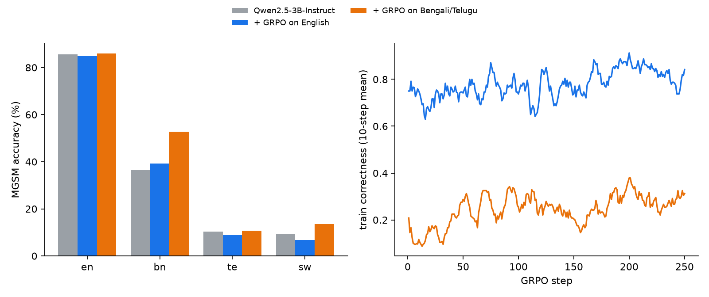

# Does RL on English math transfer to Bengali and Telugu?

A small controlled study with GRPO on Qwen2.5-3B-Instruct, run on one T4 GPU.

## Summary

Two GRPO runs used the same 1,069 GSM8K problems, the same rewards and the same 250 steps. The
only difference was the prompt language: English in one run, and Bengali or Telugu in the other.

- **English RL did not transfer.** On MGSM, the English-trained adapter moved Bengali by +2.8
  points and Telugu by -1.6 points. Neither change is significant.
- **Bengali/Telugu RL helped Bengali a lot (+16.4 points, 95% CI [+9.6, +23.2]),** but not Telugu
  (+0.4).
- The **transfer ratio** (English-arm gain / Indic-arm gain on bn+te) is **0.07**, with a 95% CI of
  [-0.43, 0.44].
- **Most of the Bengali gain comes from the model switching to English reasoning.** After Indic RL,
  76% of Bengali answers and 55% of Telugu answers reason mostly in English. The base model did
  this for 0% of them. On Bengali, the items answered in English went from 36.3% to 57.4%. Those
  items were no easier for the base model: it scored 36.7% on the items still answered in
  Bengali. The items still answered in Bengali barely moved, to 38.3%.

At this scale, then, RL on the target language did not mainly make the model reason better in
Bengali. It taught the model to stop reasoning in Bengali. A third run adds a reward for staying
in the question's script, to test whether any gain survives without the switch (see
[Consistency-reward arm](#consistency-reward-arm)).

## Setup

| | |
|---|---|
| Model | Qwen2.5-3B-Instruct, 4-bit (QLoRA), LoRA r=32 on all attention and MLP projections |
| Algorithm | GRPO (TRL 1.15 + Unsloth 2026.11.7, vLLM 0.26 generation), no KL term (beta=0) |
| Batch | 4 prompts x 6 samples per step, temperature 1.0, lr 5e-6 cosine, 250 steps (~0.94 epoch) |
| Lengths | prompt <= 384 tokens, completion <= 768 tokens |
| Rewards | 1.0 if the final number matches; 0.2 for ending with `#### <number>` |
| Hardware | one Kaggle T4 (16 GB, fp16) per run |

**Training data.** [`ai4bharat/indic-gsm8k`](https://huggingface.co/datasets/ai4bharat/indic-gsm8k)
is GSM8K test translated into Indic languages. MGSM was built from 250 GSM8K test problems. Those
are removed by normalized English-question match, which leaves 1,069 problems. The loader raises an
error unless exactly 250 are dropped, then asserts that there is no overlap. Both arms see the same
1,069 problems:

- EN arm: every problem in English.
- Indic arm: each problem in Bengali or Telugu, with a seeded 50/50 split.

**Eval.** [MGSM](https://huggingface.co/datasets/juletxara/mgsm) test set: 250 items each in en, bn,
te and sw. Swahili is a non-Indic low-resource control. Decoding is greedy with at most 1,024 new
tokens. The system prompt is "Solve the problem step by step in the same language as the question.
End with '#### <number>'." in every run.

The answer parser reads `####` first, then `\boxed{}`, then the last number. It normalizes Bengali
and Telugu digits.

**Reasoning language.** A completion counts as *English reasoning* when more than half its letters
are Latin script. For Bengali and Telugu this is exact. For Swahili it cannot separate Swahili
from English, so Swahili drift is not reported.

**Statistics.** Gains are paired over the same items, with 95% bootstrap intervals (2,000
resamples over items). The transfer ratio interval is bootstrapped over the same items. It is
reported only when the Indic-arm gain is positive in at least 90% of resamples.

**Model choice.** Qwen2.5-1.5B-Instruct scored 3.2% on Telugu. That is below the 8% floor set
before any training, so the study uses 3B ([baseline](../results/baseline/README.md)).

## Results

MGSM accuracy (%, greedy, 250 items per language):

| Model | en | bn | te | sw |
|---|---|---|---|---|
| Qwen2.5-3B-Instruct | 85.6 | 36.4 | 10.4 | 9.2 |
| + GRPO on English | 84.8 | 39.2 | 8.8 | 6.8 |
| + GRPO on Bengali/Telugu | 86.0 | 52.8 | 10.8 | 13.6 |

Gain over base (points, 95% paired bootstrap CI):

| Arm | en | bn | te | sw | bn+te |
|---|---|---|---|---|---|
| + GRPO on English | -0.8 [-4.4, +3.2] | +2.8 [-2.8, +8.4] | -1.6 [-5.6, +2.0] | -2.4 [-6.0, +1.2] | +0.6 [-2.6, +3.8] |
| + GRPO on Bengali/Telugu | +0.4 [-2.8, +3.6] | +16.4 [+9.6, +23.2] | +0.4 [-4.0, +4.4] | +4.4 [+0.0, +8.8] | +8.4 [+4.4, +12.6] |

Transfer ratio (English-arm gain / Indic-arm gain):

- bn+te: 0.07 [-0.43, 0.44]
- bn: 0.17 [-0.21, 0.47]
- te: undefined. The Indic-arm gain on Telugu is about zero.



### Why English RL had little to give

The base model already scores 85.6% on English MGSM. It started English training at 0.71 mean
correctness on its own samples and ended at 0.81. MGSM English did not move (-0.8). On Bengali and
Telugu the English adapter changed nothing visible: reasoning stayed 100% in the question's script,
and median completion length and format-error rate stayed close to the base model's. Whatever the
English run learned did not reach the model's behavior on Bengali or Telugu prompts.

### What the Indic arm learned

Training reward roughly doubled, from 0.24 to 0.48 (correctness 0.13 to 0.29). Over the same
period, the share of samples cut off at 768 tokens fell from 38.7% to 2.2%, and mean sample length
fell from 527 to 305 tokens. For comparison, English-arm samples at the start averaged 288 tokens
with 1% cut off. Reasoning in Bengali or Telugu is longer, so it is cut off before the answer more
often. Reasoning in English avoids that, and GRPO rewards it.

On MGSM:

| Indic-arm completions | n | Indic-arm acc. | Base acc. on the same items |
|---|---|---|---|
| bn, reasoning in English | 190 | 57.4 | 36.3 |
| bn, reasoning in Bengali | 60 | 38.3 | 36.7 |
| te, reasoning in English | 138 | 14.5 | 11.6 |
| te, reasoning in Telugu | 112 | 6.2 | 8.9 |

The base model scored almost the same on the Bengali items that later switched to English and on
those that did not (36.3% vs 36.7%). So the switch did not just happen on easy items, and the gain
sits almost entirely on the items that switched.

Telugu also switched (55%) but gained nothing. The 3B model's Telugu comprehension seems to be
the bottleneck: reasoning in English does not help if the question was misread.

Format compliance improved everywhere in the Indic arm. Completions missing `#### <n>` fell from
13% to 3% on bn, 52% to 16% on te and 49% to 4% on sw. The answer parser falls back to the last
number, so this is not where the accuracy gain comes from, but it may explain why Swahili moved
(+4.4, CI touching 0). The model also got much shorter on Swahili: median 1,593 characters before,
886 after.

## Consistency-reward arm

*Pending: this run (Indic arm + 0.3 x native-script share reward) is in progress.*

## Discussion

- The transfer ratio near zero is a statement about this regime: a 3B model, 250 steps, and
  English math that is already near the model's ceiling. English RL had little headroom. A weaker
  base model, or a harder English set, might show a different ratio.
- Direct Indic RL produced a large Bengali gain mainly by learning to answer in English.
  Measuring only accuracy would credit this to better Bengali reasoning. The reasoning-language
  metric shows that it is mostly routing around Bengali.
- Instruction-following degrades: the system prompt asks for reasoning in the question's language,
  and after RL the model mostly ignores that. Any deployment that cares about native-language
  explanations needs a consistency term or a filter.

## Limitations

- One seed per arm, one model size, 250 steps (under one epoch). The CIs cover item sampling,
  not training variance.
- 4-bit QLoRA on a T4. Full-precision training could behave differently.
- The training pool is a translation of GSM8K *test* (MGSM items removed), so GSM8K test scores
  from these adapters mean nothing. Only MGSM is reported.
- Reasoning language is measured by script share, not a language-ID model. It cannot see Swahili
  vs English, or code-mixed text written in one script.
- The base model was evaluated with vLLM without LoRA enabled, and the arms with a LoRA adapter
  loaded. Numerical differences between those paths are possible but small next to the effects
  reported here.
- The 768-token completion cap affects Bengali/Telugu more than English. That cap is part of
  why English reasoning is rewarded. A larger cap would weaken that pressure but cost more
  compute.

## Reproduce

```bash
pip install -e ".[dev]" && pytest -m "not net"
python scripts/train_grpo.py configs/base.yaml configs/arm_indic.yaml configs/t4.yaml --out outputs/runs/indic
python scripts/eval_mgsm.py --model Qwen/Qwen2.5-3B-Instruct --adapter outputs/runs/indic/final_adapter \
    --dtype half --out outputs/eval/indic
python scripts/analyze.py --base results/baseline/Qwen2.5-3B-Instruct --en results/full_en \
    --indic results/full_indic --out results
```

The Kaggle runners in `kaggle/` are the exact scripts used. Package versions are in
`requirements.lock`.

## Compute

All runs used one Kaggle T4.

| Run | T4 hours |
|---|---|
| Baseline evals (1.5B and 3B) | 0.5 |
| Smoke tests | 1.1 |
| English arm (train 44.9 s/step + eval) | 3.75 |
| Bengali/Telugu arm (train 74.8 s/step + eval) | 5.7 |
| Failed launch (bad timeout flag) | 0.1 |
